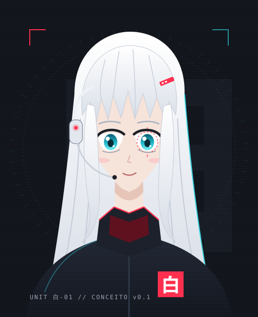

# SHIRO

> Assistente pessoal com IA para Windows: voz, automação do PC e atividades com prazo.
> Local-first, modular e seguro por padrão.

[](https://github.com/VitorAngN/Shiro-Agente/actions/workflows/ci.yml)

[](LICENSE)

**Status:** 🚧 Fase 1 · MVP de voz · marco 1a entregue: agente por texto com modelo local, ferramentas do PC e auditoria
**Autor:** Vitor ([@VitorAngN](https://github.com/VitorAngN))

---

## O que é



A **SHIRO** (白, "branco" em japonês) é uma assistente no estilo "Jarvis", com estética cyberpunk, que roda no próprio PC. Você aperta um atalho e fala:

- **"Abre o VS Code e coloca o volume em 30"**: ela executa;
- **"Anota o trabalho de cálculo pra sexta"**: ela registra a atividade, repete a data que entendeu e avisa antes do prazo;
- **"O que eu tenho essa semana?"**: ela responde em voz alta.

O modelo de linguagem é só o "cérebro" que escolhe o que fazer. Quem executa são **ferramentas** pequenas, testáveis e com nível de risco declarado. A SHIRO não depende de um único fornecedor de IA: pedidos simples ficam no PC, com um modelo local, e só o que exige mais raciocínio vai para a nuvem. E ela nunca diz que fez algo que não fez.

Persona, voz e visual: [docs/08-identidade.md](docs/08-identidade.md).

## Princípios

| Princípio | Na prática |
|---|---|
| **Local-first** | Áudio nunca sai do PC. Comandos do dia a dia e atividades funcionam offline. |
| **Agnóstico de modelo** | Ollama, Gemini, Claude e OpenAI atrás da mesma interface. Trocar é configuração. |
| **Seguro por padrão** | Toda ferramenta tem nível de risco. Ações irreversíveis exigem confirmação física. |
| **Modular** | Arquitetura hexagonal: o núcleo não conhece Windows, Ollama nem SQLite. Verificado na CI. |
| **Observável** | Cada turno do agente gera trilha de auditoria, métricas de latência e custo. |

## Arquitetura em 30 segundos


Detalhes completos em [docs/03-arquitetura.md](docs/03-arquitetura.md).

## Como rodar

Requisitos: Windows 10/11, Git, [uv](https://docs.astral.sh/uv/) e [Ollama](https://ollama.com). GPU NVIDIA com 4 GB+ recomendada.

```powershell
git clone https://github.com/VitorAngN/Shiro-Agente.git
cd Shiro-Agente
uv sync
ollama pull qwen3:4b-instruct

uv run shiro chat -v         # conversa por texto; -v mostra camada, tempo e ferramentas
uv run shiro config path     # mostra onde fica o shiro.toml
uv run shiro config check    # valida a configuração
```

Voz (marco 1b):

```powershell
uv run shiro voice setup     # baixa o Whisper e a voz Kokoro (uma vez, ~600 MB)
uv run shiro voice devices   # lista microfones e saídas
uv run shiro voice listen    # testa o microfone: ouve uma frase e mostra o texto
uv run shiro voice -v        # conversa por voz: Ctrl+Alt+Espaço fala, Ctrl+Alt+Shift+S para
uv run shiro voice bench     # mede voz e transcrição sem tocar áudio
```

Exemplo de sessão:

```text
você > que horas são?
shiro > São 17h24 de sábado, 31 de outubro.
  [T0 · regra · 0,01 s · get_time ✓]
você > quanto de memória ram eu tô usando?
shiro > Você está usando 17,6 GB de um total de 23,8 GB de RAM, o que é 74% do uso.
  [T1 · ollama/qwen3:4b-instruct · 2,36 s · system_info ✓]
você > abre o vs code
  ⚠ Abrir o VS Code? [confirmação: s/N] s
shiro > Abrindo o VS Code.
  [T0 · regra · 7,54 s · open_app ✓]
```

Para personalizar, copie [`config/shiro.example.toml`](config/shiro.example.toml) para o caminho mostrado por `shiro config path`. Sem arquivo, o SHIRO usa padrões seguros.

## Stack

| Camada | Tecnologia |
|---|---|
| Linguagem | Python 3.12, `asyncio` |
| LLM local | Ollama, modelo de 3–4B escolhido por benchmark próprio (provisório: `qwen3:4b-instruct`) |
| LLM nuvem | Gemini, Claude, OpenAI (adaptadores próprios) |
| Fala → texto | faster-whisper na CPU + Silero VAD |
| Texto → fala | Voz feminina pt-BR: Kokoro `pf_dora` em processo separado; reserva: voz Maria do Windows (SAPI) |
| Palavra de ativação | openWakeWord ("Ei, Shiro") |
| Persistência | SQLite (WAL) + sqlite-vec |
| Casa (futuro) | Home Assistant via MCP |
| Qualidade | uv, ruff, pyright, import-linter, pytest, pre-commit, gitleaks, pip-audit, GitHub Actions |

## Documentação

| Documento | Conteúdo |
|---|---|
| [01 · Visão e escopo](docs/01-visao-e-escopo.md) | Problema, objetivos, não-objetivos, casos de uso |
| [02 · Requisitos](docs/02-requisitos.md) | Requisitos funcionais e não funcionais com metas mensuráveis |
| [03 · Arquitetura](docs/03-arquitetura.md) | Contexto, contêineres, componentes, fluxos, interfaces |
| [04 · Modelo de dados](docs/04-modelo-de-dados.md) | Entidades, relacionamentos e retenção |
| [05 · Segurança](docs/05-seguranca.md) | Níveis de risco, modelo de ameaças, mitigações |
| [06 · Roadmap](docs/06-roadmap.md) | Fases, entregas e critérios de pronto |
| [07 · Desenvolvimento](docs/07-desenvolvimento.md) | Ambiente, convenções, testes e avaliação |
| [08 · Identidade](docs/08-identidade.md) | Quem é a SHIRO: persona, voz, aparência e paleta |
| [ADRs](docs/adr/README.md) | Registro das decisões de arquitetura |
| [Benchmarks](docs/benchmarks/2026-10-31-modelo-local.md) | Medições no hardware real |

## Privacidade

Este repositório é público; os dados de quem usa o SHIRO não são. Configuração real, banco de dados, logs e chaves de API ficam fora da pasta do projeto, e a CI bloqueia commits com segredos. Detalhes em [docs/05-seguranca.md](docs/05-seguranca.md#repositorio-publico).

Encontrou uma vulnerabilidade? Veja [SECURITY.md](SECURITY.md).

## Licença

[MIT](LICENSE). Componentes com licença GPL (espeak-ng e phonemizer, usados pela voz Kokoro) rodam num processo separado e nunca são importados pelo SHIRO ([ADR-0015](docs/adr/0015-implementacao-da-voz.md)).
