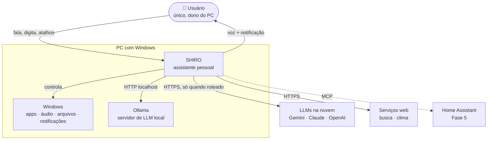
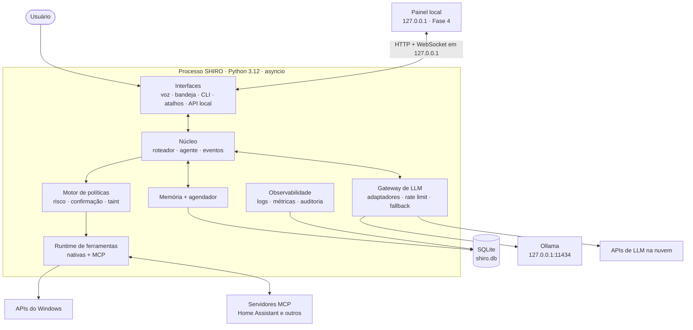
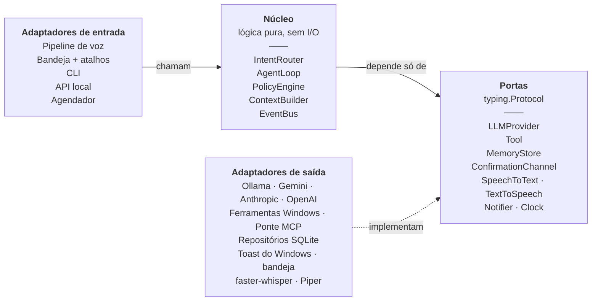
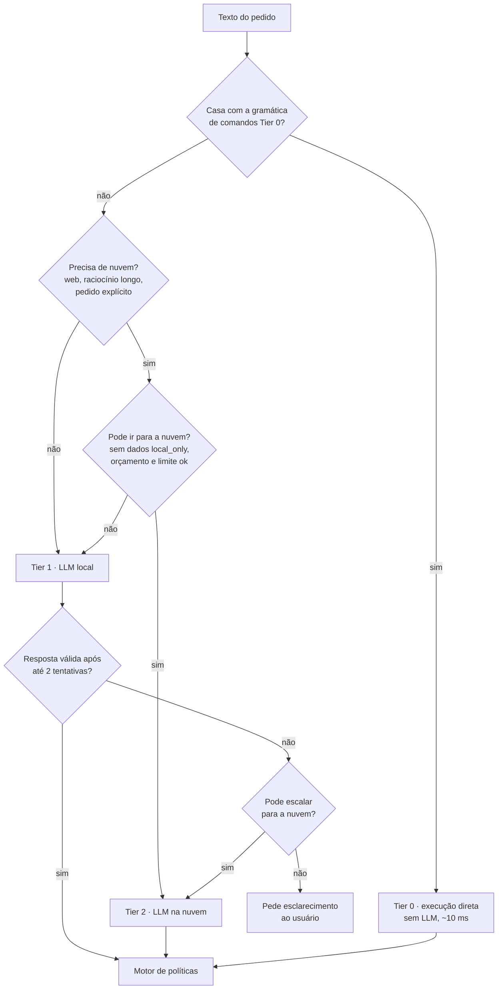
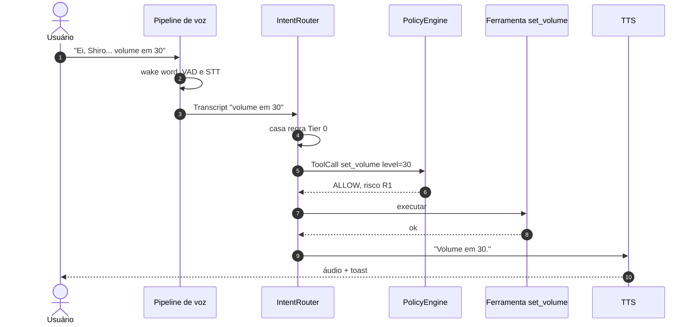
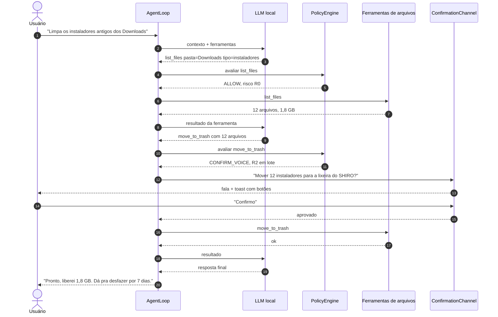
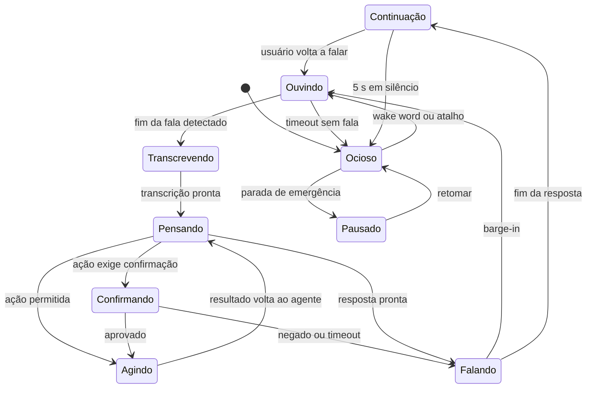
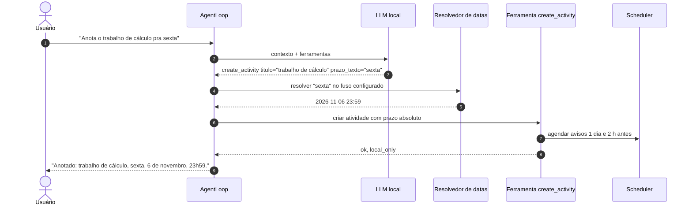

# 03 · Arquitetura

Este documento descreve a arquitetura do SHIRO em níveis de zoom crescentes (inspirado no modelo C4): contexto, contêineres, componentes e, por fim, os fluxos e contratos internos. As decisões que justificam cada escolha estão nos [ADRs](adr/README.md).

## 1. Estilo arquitetural

| Escolha | Motivo | ADR |
|---|---|---|
| **Monólito modular** em um único processo Python | Um usuário, um PC. Microsserviços só trariam latência e complexidade operacional | [0002](adr/0002-monolito-modular-hexagonal.md) |
| **Arquitetura hexagonal** (portas e adaptadores) | O núcleo fica testável e independente de Windows, Ollama e SQLite | [0002](adr/0002-monolito-modular-hexagonal.md) |
| **Barramento de eventos interno** assíncrono | Desacopla voz, agente, interface e observabilidade | [0002](adr/0002-monolito-modular-hexagonal.md) |
| **Roteamento em três camadas** (Tier 0/1/2) | Comandos simples sem LLM, o dia a dia no modelo local, o difícil na nuvem | [0003](adr/0003-roteamento-hibrido-de-llm.md) |
| **Ferramentas com risco declarado** e motor de políticas | Segurança como regra do sistema, não como pedido educado ao modelo | [0005](adr/0005-ferramentas-com-politica-de-risco.md) |

## 2. Contexto (nível 1)



## 3. Contêineres (nível 2)

Tudo que está dentro do retângulo é **um único processo**. Os blocos são módulos Python, não serviços separados.



## 4. Componentes (nível 3): portas e adaptadores



**Regra de dependência:** `core` e `policy` não importam nada de `voice`, `llm`, `tools/builtin`, `persistence` ou `interfaces`. Eles dependem só das portas. A ligação concreta acontece em um único lugar, a *composition root* (`app.py`). A regra é verificada na CI com `import-linter`.

### 4.1 Responsabilidades

| Componente | Responsabilidade | Não faz |
|---|---|---|
| `IntentRouter` | Classifica o pedido em Tier 0, 1 ou 2 e escolhe o provedor | Executar ferramentas |
| `AgentLoop` | Conduz o ciclo LLM → chamada de ferramenta → resultado → LLM, com limites de passos e tempo | Decidir se uma ação é permitida |
| `PolicyEngine` | Decide `ALLOW`, `CONFIRM_VOICE`, `CONFIRM_PHYSICAL` ou `DENY` para cada chamada | Falar com o usuário |
| `ContextBuilder` | Monta o prompt: persona, memórias relevantes, histórico recente, ferramentas disponíveis | Persistir dados |
| `EventBus` | Pub/sub assíncrono e tipado entre módulos | Lógica de negócio |
| `LLM Gateway` | Normaliza provedores para um formato interno; rate limit, retry, fallback, contagem de custo | Decidir qual Tier usar |
| `ToolRegistry` | Registra ferramentas nativas e importadas via MCP, valida argumentos (Pydantic) | Avaliar risco |
| `Pipeline de voz` | Captura, palavra de ativação, VAD, STT, TTS, barge-in | Interpretar o pedido |
| `MemoryStore` | Memória de curto prazo (sessão) e de longo prazo (fatos + embeddings) | Decidir o que vale lembrar |
| `Scheduler` | Lembretes, timers e rotinas persistentes | Executar ações sem passar pela política |
| `Activities` | Atividades com prazo: criar, listar, concluir, adiar; resolver datas em pt-BR; agendar avisos | Interpretar a frase inteira (isso é do agente) |
| `AuditLog` | Registro append-only de toda decisão e ação | Ser editado ou apagado pela aplicação |

## 5. Roteamento em camadas



- **Tier 0** cobre os ~20 comandos mais frequentes ("volume em 30", "pausa", "abre o Spotify") com uma gramática de regras em português. É o caminho mais rápido e não falha por causa de modelo.
- **Tier 1** é o padrão para todo o resto. O modelo local roda pelo Ollama.
- **Tier 2** entra por regra (busca na web, pedido explícito como "pensa bem nisso", contexto grande) ou por escalonamento quando o Tier 1 falha na validação.
- "Resposta válida" significa JSON que respeita o schema da ferramenta, ferramenta existente e argumentos aprovados pelo Pydantic.

## 6. Loop do agente

```python
async def run_turn(request: UserRequest) -> AgentResult:
    ctx = await context_builder.build(request)          # persona + memórias + histórico + ferramentas
    provider = router.select(request, ctx)              # Tier 1 ou Tier 2
    for step in range(settings.agent.max_steps):        # padrão: 8
        reply = await llm.complete(provider, ctx, timeout=settings.agent.step_timeout)
        if reply.is_final:
            return AgentResult(text=reply.text)
        for call in reply.tool_calls:
            decision = policy.evaluate(call, ctx)       # ALLOW | CONFIRM_* | DENY
            if decision.needs_confirmation:
                decision = await confirmation.ask(decision.prompt, decision.channel)
            result = await tools.execute(call) if decision.allowed else ToolResult.denied(decision.reason)
            audit.record(call, decision, result)
            ctx.add_tool_result(call, result, trusted=call.spec.output_trusted)
    return AgentResult(text="Não consegui concluir em poucos passos. Quer que eu tente de outro jeito?")
```

Detalhes importantes:

- Resultados de ferramentas que trazem conteúdo externo (página web, arquivo, MCP) entram no contexto **marcados como não confiáveis**. A partir daí a sessão fica com *taint* e o motor de políticas endurece (ver [Segurança](05-seguranca.md#taint)).
- Resultados longos são truncados e resumidos antes de voltar ao modelo, para caber no contexto de 4096 tokens do modelo local ([ADR-0010](adr/0010-hardware-gpu-4gb.md)).
- **Verificação de ação alegada:** antes de ir para o TTS, o texto final é comparado com as ferramentas realmente executadas no turno. Se ele afirma uma ação ("marquei", "abri", "pronto") que nenhuma ferramenta executou, a resposta é bloqueada e o turno é refeito ou escalado ([ADR-0011](adr/0011-ajustes-do-benchmark-local.md), RF-16).
- A persona e as ferramentas vão sempre no início do pedido, na mesma ordem, para aproveitar o cache de prefixo do Ollama. O SHIRO aquece esse cache ao iniciar.
- O texto final é dividido por frases e enviado ao TTS em streaming: o SHIRO começa a falar antes de terminar de gerar.

## 7. Fluxos principais

### 7.1 Comando simples por voz (Tier 0)



### 7.2 Tarefa com várias etapas e confirmação (Tier 1)



### 7.3 Máquina de estados da sessão de voz



A **parada de emergência** (RF-60) leva qualquer estado para `Pausado`: cancela a tarefa do turno atual, interrompe o TTS e fecha o microfone. Enquanto o SHIRO fala, a detecção da palavra de ativação ignora o próprio áudio para evitar que ele se ative sozinho (ver [ADR-0004](adr/0004-pipeline-de-voz-local.md)).

### 7.4 Registrar uma atividade por voz



O modelo nunca calcula a data: ele só extrai a expressão, e o resolvedor determinístico faz a conta ([ADR-0009](adr/0009-voz-e-atividades-no-mvp.md)). Se a expressão for ambígua, o SHIRO pergunta antes de salvar.

## 8. Contratos internos (portas)

```python
from typing import AsyncIterator, Protocol
from pydantic import BaseModel

class LLMProvider(Protocol):
    name: str                       # "ollama", "gemini", "anthropic", "openai"
    supports_tools: bool
    async def complete(self, req: CompletionRequest) -> CompletionResponse: ...
    def stream(self, req: CompletionRequest) -> AsyncIterator[CompletionChunk]: ...

class ToolSpec(BaseModel):
    name: str                       # snake_case, único
    description: str                # o que o modelo lê para decidir usar
    args_model: type[BaseModel]     # validação e JSON Schema gerados do Pydantic
    risk: RiskLevel                 # R0..R4
    timeout_s: float = 10.0
    output_trusted: bool = True     # False se devolve conteúdo externo
    local_only: bool = False        # True se o resultado nunca pode ir para a nuvem

class Tool(Protocol):
    spec: ToolSpec
    async def run(self, args: BaseModel, ctx: ToolContext) -> ToolResult: ...

class ConfirmationChannel(Protocol):
    async def ask(self, prompt: str, kind: ConfirmationKind, timeout_s: float) -> ConfirmationResult: ...

class SpeechToText(Protocol):
    async def transcribe(self, clip: AudioClip) -> Transcript: ...

class TextToSpeech(Protocol):
    def synthesize(self, text: str) -> AsyncIterator[AudioChunk]: ...

class WakeWordDetector(Protocol):
    def process(self, frame: AudioFrame) -> WakeEvent | None: ...

class MemoryStore(Protocol):
    async def remember(self, fact: MemoryFact) -> None: ...
    async def recall(self, query: str, k: int = 5) -> list[MemoryFact]: ...
    async def forget(self, fact_id: str) -> None: ...
```

O formato interno de mensagens e chamadas de ferramenta é próprio do SHIRO. Cada adaptador converte de e para o formato do seu provedor ([ADR-0003](adr/0003-roteamento-hibrido-de-llm.md)).

## 9. Eventos internos

Todos os eventos carregam `trace_id`, `ts` e são modelos Pydantic imutáveis.

| Evento | Publicado por | Consumido por |
|---|---|---|
| `WakeWordDetected` | voz | bandeja, voz |
| `UtteranceCaptured` | voz | STT |
| `TranscriptReady` | STT | núcleo |
| `TurnStarted` / `TurnFinished` | núcleo | bandeja, observabilidade |
| `ToolCallRequested` | agente | política, auditoria |
| `ConfirmationRequired` / `ConfirmationResolved` | política | voz, bandeja, painel |
| `ToolCallCompleted` | runtime de ferramentas | agente, auditoria |
| `ResponseReady` | núcleo | TTS, toast |
| `SpeechStarted` / `SpeechFinished` | TTS | voz (supressão de eco), bandeja |
| `EmergencyStop` | atalho | todos |
| `ComponentFailed` / `ComponentRestarted` | supervisor | observabilidade, bandeja |

## 10. Concorrência e execução

| Parte | Onde roda | Por quê |
|---|---|---|
| Captura de áudio | thread do `sounddevice` | Callback de tempo real. Entrega quadros ao loop via `call_soon_threadsafe` |
| Wake word + VAD | loop `asyncio`, quadros de 80 ms a 16 kHz | Processamento leve e contínuo |
| STT e TTS | `ThreadPoolExecutor` | Inferência pesada que libera o GIL. Não pode travar o loop |
| LLM | HTTP assíncrono (`httpx`) | Ollama e nuvem são I/O |
| Ferramentas do Windows | `asyncio.to_thread` | APIs COM/Win32 são bloqueantes |
| Supervisor | tarefa `asyncio` | Reinicia componentes que falham, com backoff (RNF-08) |

## 11. Orçamentos

### 11.1 VRAM (GTX 1650, 4 GB)

Valores medidos e estimados para o hardware real ([ADR-0010](adr/0010-hardware-gpu-4gb.md), [benchmark](benchmarks/2026-10-31-modelo-local.md)).

| Componente | Uso | Observação |
|---|---|---|
| Tela do Windows | ~0 | A tela não usa a placa NVIDIA; apps com aceleração de hardware podem usar |
| LLM `qwen3:4b-instruct` com contexto de 4096 tokens | **2,96 GB (medido)** | Pesos, cache de contexto e buffers, com `num_gpu = 99` |
| STT faster-whisper | 0 | Roda na CPU em int8 |
| Piper TTS | 0 | Roda na CPU |
| **Total na placa** | **3,1 de 4 GB (medido)** | Cabe sem transbordar para a CPU; ~1 GB livre |

Mitigações: descarregar o modelo após inatividade (`keep_alive` do Ollama) e o **Modo Desempenho** (RF-26), que libera a GPU para jogos ou trabalho pesado e deixa ativos só o Tier 0 e a nuvem.

### 11.2 Latência (Tier 1, comando curto)

| Estágio | Meta / estimativa |
|---|---|
| Detecção de fim de fala (VAD) | ~300 ms |
| STT de frase curta na CPU | ~500–1000 ms (a medir no marco 1b) |
| LLM local até a chamada de ferramenta | **0,6–1,1 s (medido, p50 0,63 s)**, com o prefixo em cache |
| Execução da ferramenta | ~50–200 ms |
| TTS até o primeiro áudio | ~150–300 ms |
| **Total p50** | **meta ≤ 2,5 s** (RNF-01) · **estimativa atual 1,6–2,9 s**, a confirmar com a voz no marco 1b |

Cada estágio vira uma métrica com `trace_id`, então dá para ver onde o tempo é gasto.

## 12. Estrutura do código

```text
src/shiro/
├── __main__.py              # ponto de entrada: python -m shiro
├── app.py                   # composition root: monta e liga tudo
├── settings.py              # pydantic-settings + shiro.toml
├── core/                    # lógica pura, sem I/O
│   ├── models.py            # entidades e value objects
│   ├── events.py            # eventos tipados
│   ├── bus.py               # EventBus
│   ├── ports.py             # Protocols
│   ├── router.py            # IntentRouter (Tier 0/1/2)
│   ├── intents/             # gramática Tier 0 em pt-BR
│   ├── agent.py             # AgentLoop
│   └── context.py           # ContextBuilder + persona
├── policy/                  # PolicyEngine, níveis de risco, taint
├── llm/                     # adaptadores + rate limiter + custo
│   ├── ollama.py
│   ├── gemini.py
│   ├── anthropic.py
│   └── openai.py
├── voice/                   # áudio, wake word, VAD, STT, TTS
├── tools/
│   ├── registry.py
│   ├── builtin/             # apps, áudio, mídia, sistema, arquivos, web, tempo
│   └── mcp/                 # ponte MCP → Tool
├── activities/              # atividades com prazo: modelo, regras, datas, ferramentas
├── memory/                  # curto e longo prazo, embeddings
├── scheduler/               # lembretes, timers, rotinas
├── persistence/             # SQLite, migrações, repositórios
├── interfaces/              # bandeja, atalhos, CLI, API local, toast
└── observability/           # logs, métricas, auditoria, supervisor
```

## 13. Implantação no Windows

- **Instalação:** `scripts/install_windows.ps1` instala o ambiente com `uv`, verifica o Ollama, baixa o modelo padrão e as vozes do Piper.
- **Execução:** processo do usuário iniciado no logon pelo Agendador de Tarefas (`scripts/register_startup.ps1`). Não é um Serviço do Windows, porque serviços rodam isolados da área de trabalho e dos dispositivos de áudio do usuário ([ADR-0008](adr/0008-processo-de-usuario-no-windows.md)).
- **Instância única:** um mutex nomeado impede dois SHIROs ao mesmo tempo.
- **Dados:** `%LOCALAPPDATA%\SHIRO\` guarda `shiro.db`, logs, a lixeira do SHIRO e os modelos de voz. A configuração fica em `%APPDATA%\SHIRO\shiro.toml`.
- **Segredos:** chaves de API no Gerenciador de Credenciais do Windows, via `keyring`. Nunca no `.toml`.
- **API local:** escuta só em `127.0.0.1`, com token gerado na instalação.

## 14. Observabilidade

| Sinal | Como |
|---|---|
| Logs | `structlog` em JSON, rotação por tamanho, `trace_id` em toda linha |
| Métricas | Latência por estágio, tokens, custo estimado por provedor, taxa de acerto do Tier 1, falsos disparos |
| Auditoria | Tabela `audit_event` append-only, com hash encadeado para detectar adulteração |
| Saúde | Supervisor publica `ComponentFailed` e `ComponentRestarted`, e a bandeja muda de cor |

## 15. Glossário

| Termo | Significado |
|---|---|
| **Tier 0/1/2** | Camadas de roteamento: regra direta, LLM local, LLM na nuvem |
| **Ferramenta (tool)** | Função que o agente pode chamar, com schema de argumentos e risco declarado |
| **Porta / adaptador** | Interface do núcleo / implementação concreta dela |
| **R0–R4** | Níveis de risco das ferramentas (ver [Segurança](05-seguranca.md)) |
| **Taint** | Marca de que o contexto contém conteúdo externo não confiável |
| **MCP** | Model Context Protocol, protocolo aberto para expor ferramentas a agentes |
| **VAD** | Voice Activity Detection: detecta início e fim de fala |
| **STT / TTS** | Fala para texto / texto para fala |
| **Barge-in** | Interromper o assistente enquanto ele fala |
