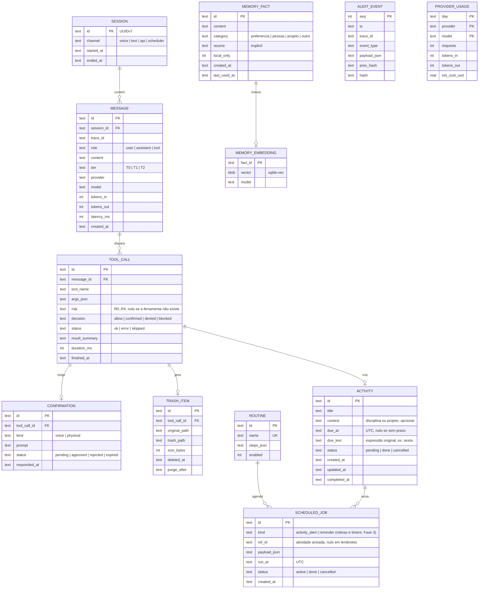

# 04 · Modelo de dados

Todo o estado persistente fica em um único arquivo SQLite (`%LOCALAPPDATA%\SHIRO\shiro.db`), em modo WAL, com migrações versionadas. Justificativa em [ADR-0007](adr/0007-sqlite-para-persistencia.md).

## 1. Diagrama entidade-relacionamento

`AUDIT_EVENT` e `PROVIDER_USAGE` não têm chave estrangeira de propósito: a auditoria precisa sobreviver mesmo se o histórico de conversas for apagado.

## 2. Decisões de modelagem

| Decisão | Motivo |
|---|---|
| IDs em **UUIDv7** | Ordenáveis por tempo, sem colisão, sem expor contagem |
| Datas em texto **ISO 8601 UTC** | Padrão do SQLite, legível e ordenável. Conversão para o fuso local só na interface |
| `args_json` e `payload_json` em JSON | Cada ferramenta tem argumentos diferentes. A validação acontece no Pydantic, não no banco |
| `MEMORY_EMBEDDING` separada de `MEMORY_FACT` | Permite trocar o modelo de embedding e reindexar sem perder os fatos |
| `AUDIT_EVENT` com **hash encadeado** | `hash = sha256(prev_hash + payload)`. Qualquer edição quebra a cadeia e é detectada na inicialização |
| `PROVIDER_USAGE` agregado por dia | Base do orçamento diário de nuvem (RNF-10) sem varrer o histórico |
| `ACTIVITY.due_text` guarda a expressão original | Permite auditar e testar o resolvedor de datas: "o que foi dito" versus "o que foi entendido" ([ADR-0009](adr/0009-voz-e-atividades-no-mvp.md)) |
| Avisos de atividade como `SCHEDULED_JOB` | Um único agendador para lembretes, rotinas e avisos; adiar uma atividade só reagenda os jobs ligados a ela |
| Gatilhos `UPDATE` e `DELETE` bloqueados em `AUDIT_EVENT` | A aplicação só consegue inserir |

## 3. Memória: o que entra e o que não entra

| Entra | Não entra |
|---|---|
| Fatos que eu peço explicitamente: "lembra que…" | Inferências do modelo sobre mim |
| Preferências de uso: apps favoritos, volume preferido, horários | Conteúdo de arquivos pessoais |
| Nomes de projetos e matérias, para dar contexto | Senhas, tokens, documentos, dados bancários |

`local_only = 1` impede que o fato seja incluído em um contexto enviado para a nuvem. O padrão para fatos novos é `1`, e o usuário libera caso a caso.

## 4. Retenção

| Dado | Retenção padrão | Configurável |
|---|---|---|
| Áudio | Não é gravado | Pode ser ativado para depuração, com expiração de 24 h |
| `SESSION`, `MESSAGE`, `TOOL_CALL` | 90 dias | Sim |
| `TRASH_ITEM` e arquivos na lixeira | 7 dias, depois limpeza definitiva | Sim |
| `MEMORY_FACT` | Até eu pedir para esquecer | — |
| `ACTIVITY` pendente | Até ser concluída ou excluída | — |
| `ACTIVITY` concluída ou cancelada | 1 ano | Sim |
| `AUDIT_EVENT` | 1 ano | Sim, mas nunca menos que o histórico de mensagens |
| Logs em arquivo | 5 arquivos de 10 MB, em rotação | Sim |

A limpeza roda como tarefa interna do agendador, uma vez por dia, e também é registrada na auditoria.

## 5. Migrações

Migrações SQL numeradas em `src/shiro/infrastructure/persistence/migrations/` (`0001_init.sql`, `0002_…`), aplicadas na inicialização dentro de uma transação, com a versão registrada em `PRAGMA user_version`. Antes de migrar, o SHIRO copia o banco para `shiro.db.bak`.
