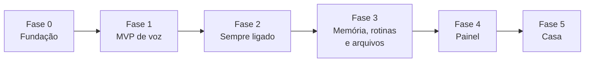

# 06 · Roadmap

O SHIRO cresce em fases pequenas. Cada uma termina com algo **usável** e com critérios de pronto mensuráveis. Uma fase só começa quando a anterior cumpre seus critérios.

A voz faz parte do MVP desde a Fase 1 ([ADR-0009](adr/0009-voz-e-atividades-no-mvp.md)).

## Fase 0 · Fundação

**Objetivo:** repositório profissional pronto para receber código.

| Entrega | Detalhe |
|---|---|
| Documentação | Este conjunto de documentos e ADRs |
| Projeto Python | `pyproject.toml`, layout `src/`, `uv`, Python 3.12 |
| Qualidade | ruff, pyright, pytest, pre-commit, `import-linter`, `gitleaks` |
| CI | GitHub Actions: lint, tipos, arquitetura, testes em Ubuntu e Windows, segurança |
| Base | Configuração (`shiro.toml`), logging estruturado, CLI `shiro --version` e `shiro config check` |

**Pronto quando:** CI verde, `shiro --version` funciona e o README explica como rodar.

## Fase 1 · MVP de voz

**Objetivo:** apertar um atalho, falar, e o SHIRO executar comandos e anotar atividades.

A fase é entregue em três marcos, cada um testável sozinho:

| Marco | Entrega |
|---|---|
| **1a · Cérebro** | `EventBus`, `AgentLoop`, `ContextBuilder`, `IntentRouter` com Tier 0; adaptadores Ollama e Gemini com rate limiter e fallback; `PolicyEngine` com níveis R0–R4; SQLite com `SESSION`, `MESSAGE`, `TOOL_CALL`, `AUDIT_EVENT`; ferramentas de hora/data, clima, apps, volume, mídia e sistema; aquecimento do modelo e verificação de ação alegada ([ADR-0011](adr/0011-ajustes-do-benchmark-local.md)); modo texto pela CLI |
| **1b · Voz** | Push-to-talk por atalho global; captura com `sounddevice`; Silero VAD; faster-whisper; Kokoro `pf_dora` em processo separado (reserva: voz Maria do Windows) com fala frase a frase; confirmação por voz; lembretes falados; parada de emergência ([ADR-0015](adr/0015-implementacao-da-voz.md)) |
| **1c · Atividades** | Entidade `ACTIVITY`; ferramentas para criar, listar, concluir, adiar, editar e excluir; interpretação de datas em pt-BR; confirmação falada da data; avisos antes do prazo pelo agendador |

**Andamento do marco 1a:**

| Item | Estado |
|---|---|
| `AgentLoop`, `EventBus`, `ContextBuilder`, `IntentRouter` com Tier 0 em pt-BR | ✅ |
| `PolicyEngine` R0–R4 com taint, lote e modo somente leitura | ✅ |
| Adaptador Ollama com `num_gpu`, `keep_alive` e aquecimento | ✅ |
| SQLite com migrações, histórico e auditoria com hash encadeado | ✅ |
| Ferramentas: hora, clima, sistema, volume, mídia, abrir e fechar apps | ✅ validadas no Windows real |
| Verificação de ação alegada (RF-16) | ✅ |
| `shiro chat` com confirmação pelo teclado | ✅ |
| Adaptador Gemini (Tier 2), rate limiter, orçamento diário e fallback | ✅ (falta só a chave: `shiro secrets set gemini`) |
| Avaliação do agente completo (não só do modelo) com o conjunto em pt-BR | ✅ `evals/run_agent.py` |

**Andamento do marco 1c:**

| Item | Estado |
|---|---|
| Resolução de prazos em pt-BR, determinística (51 casos na tabela de testes) | ✅ |
| `ACTIVITY` e `SCHEDULED_JOB` (migração 0002) | ✅ |
| Criar, listar, concluir, adiar, renomear e excluir atividades; lembretes | ✅ |
| Data absoluta repetida em toda criação e adiamento (RF-35) | ✅ |
| Avisos antes do prazo e lembretes pelo agendador (RF-38) | ✅ no modo texto; na voz e na bandeja, com o 1b e a Fase 2 |
| "Terminei X" e "o que eu tenho essa semana?" no Tier 0 | ✅ |

**Spikes desta fase:**

- benchmark dos modelos locais candidatos → escolha do modelo padrão ([ADR-0003](adr/0003-roteamento-hibrido-de-llm.md));
- medição de VRAM e latência por estágio → onde o STT roda e com qual modelo ([ADR-0004](adr/0004-pipeline-de-voz-local.md)).

**Pronto quando:**

- ≥ 90% de acerto de ferramenta na avaliação com o modelo padrão (RNF-03);
- ≥ 95% de datas corretas nos casos de atividades (RNF-16);
- latência p50 dentro do RNF-01 para Tier 0 e Tier 1;
- auditoria registrando 100% das chamadas;
- cobertura ≥ 80% no núcleo.

## Fase 2 · Sempre ligado

**Objetivo:** o SHIRO vira parte do PC.

| Entrega | Detalhe |
|---|---|
| Wake word | ✅ "Ei, Shiro" pelo motor Whisper, sem treino; openWakeWord em ONNX para modelo treinado ([guia](guias/treinar-ei-shiro.md)) |
| Bandeja | ✅ Ícone com estados, menu (falar, parar, "Ei, Shiro", liberar GPU, iniciar com o Windows, registros, sair), notificações |
| Conversa | ✅ Janela de continuação e barge-in (o atalho interrompe a fala) |
| Sistema | ✅ Início no logon (Agendador, reserva no registro), instância única, reinício da escuta se o microfone cair |
| Desempenho | ✅ Primeira versão: liberar a GPU pela bandeja (RF-26) |
| Atividades | ✅ Resumo do dia numa notificação ao iniciar (RF-39) |

Decisões no [ADR-0016](adr/0016-sempre-ligado.md).

**Pronto quando:** uma semana de uso real dentro das metas do RNF-04 e sem travamentos que exijam reiniciar o processo.

## Fase 3 · Memória, rotinas e arquivos

| Entrega | Detalhe |
|---|---|
| Memória | ✅ Fatos explícitos, embeddings locais (MiniLM multilíngue), `local_only`, lembrar, listar e esquecer ([ADR-0017](adr/0017-memoria-local.md)) |
| Rotinas | ✅ Rotinas nomeadas no `shiro.toml`, validadas na partida, cada passo pela política |
| Arquivos | ✅ Pastas permitidas, lixeira da SHIRO com restauração, organizar com o plano na confirmação |
| Confirmação | ✅ `CONFIRM_PHYSICAL` por janela "Sim/Não" na bandeja (ADR-0016) |
| Web | ✅ Busca e resumo com fontes pelo Gemini, nos limites do Tier 2 |
| Escala | ✅ Ferramentas por assunto: o modelo só vê os grupos do pedido ([ADR-0018](adr/0018-rotinas-arquivos-web.md)) |

**Pronto quando:** rotina "modo estudo" funcionando de ponta a ponta e lixeira restaurando arquivos corretamente nos testes.

## Fase 4 · Painel local

| Entrega | Detalhe |
|---|---|
| API | ✅ FastAPI no loopback, no processo da SHIRO: link de entrada de uso único, cookie `HttpOnly`, `Host` e `Origin` conferidos, CSP estrita ([ADR-0019](adr/0019-painel-local.md)) |
| Ao vivo | ✅ WebSocket com os eventos do turno (início, cada ferramenta, fim) |
| Painel | ✅ Página sem build (sem React): turnos com camada, tempo e decisão da política, p50/p95 por camada, atividades, memórias com "Esquecer", rotinas, auditoria com verificação da cadeia e custos |
| Acesso | ✅ "Abrir painel" na bandeja e `shiro dashboard` |

**Pronto quando:** dá para diagnosticar um turno lento ou uma ação negada só pelo painel.

## Fase 5 · Casa

| Entrega | Detalhe |
|---|---|
| Infra | Home Assistant em máquina sempre ligada |
| Integração | Cliente MCP do SHIRO conectado ao Home Assistant ([ADR-0006](adr/0006-home-assistant-via-mcp.md)) |
| Dispositivos | Primeiros dispositivos com controle local |
| Política | Mapeamento de risco por domínio (luz R1, fechadura R3) |

**Pronto quando:** "Ei, Shiro, apaga a luz do quarto" funciona com a internet desligada.

## Ideias futuras (sem compromisso)

- Sincronizar atividades com um calendário ou app de tarefas externo (RF-40)
- Verificação de locutor, para só obedecer à minha voz
- Acesso pelo celular via VPN privada
- Entender o que está na tela (modelo com visão)
- Cancelamento de eco para usar sem fone
- Plugins de terceiros com isolamento em processo separado
