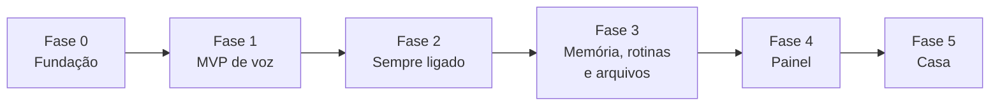

# 06 · Roadmap

O SHIRO cresce em fases pequenas. Cada uma termina com algo **usável** e com critérios de pronto mensuráveis. Uma fase só começa quando a anterior cumpre seus critérios.

A voz faz parte do MVP desde a Fase 1 ([ADR-0009](adr/0009-voz-e-atividades-no-mvp.md)).

## Fase 0 · Fundação

**Objetivo:** repositório profissional pronto para receber código.

| Entrega | Detalhe |
|---|---|
| Documentação | Este conjunto de documentos e ADRs |
| Projeto Python | `pyproject.toml`, layout `src/`, `uv`, Python 3.12 |
| Qualidade | ruff, pyright, pytest, pre-commit, `import-linter`, `gitleaks` |
| CI | GitHub Actions: lint, tipos, arquitetura, testes em Ubuntu e Windows, segurança |
| Base | Configuração (`shiro.toml`), logging estruturado, CLI `shiro --version` e `shiro config check` |

**Pronto quando:** CI verde, `shiro --version` funciona e o README explica como rodar.

## Fase 1 · MVP de voz

**Objetivo:** apertar um atalho, falar, e o SHIRO executar comandos e anotar atividades.

A fase é entregue em três marcos, cada um testável sozinho:

| Marco | Entrega |
|---|---|
| **1a · Cérebro** | `EventBus`, `AgentLoop`, `ContextBuilder`, `IntentRouter` com Tier 0; adaptadores Ollama e Gemini com rate limiter e fallback; `PolicyEngine` com níveis R0–R4; SQLite com `SESSION`, `MESSAGE`, `TOOL_CALL`, `AUDIT_EVENT`; ferramentas de hora/data, clima, apps, volume, mídia e sistema; aquecimento do modelo e verificação de ação alegada ([ADR-0011](adr/0011-ajustes-do-benchmark-local.md)); modo texto pela CLI |
| **1b · Voz** | Push-to-talk por atalho global; captura com `sounddevice`; Silero VAD; faster-whisper; Piper como processo separado com streaming por frase; toast do Windows; parada de emergência |
| **1c · Atividades** | Entidade `ACTIVITY`; ferramentas para criar, listar, concluir, adiar, editar e excluir; interpretação de datas em pt-BR; confirmação falada da data; avisos antes do prazo pelo agendador |

**Spikes desta fase:**

- benchmark dos modelos locais candidatos → escolha do modelo padrão ([ADR-0003](adr/0003-roteamento-hibrido-de-llm.md));
- medição de VRAM e latência por estágio → onde o STT roda e com qual modelo ([ADR-0004](adr/0004-pipeline-de-voz-local.md)).

**Pronto quando:**

- ≥ 90% de acerto de ferramenta na avaliação com o modelo padrão (RNF-03);
- ≥ 95% de datas corretas nos casos de atividades (RNF-16);
- latência p50 dentro do RNF-01 para Tier 0 e Tier 1;
- auditoria registrando 100% das chamadas;
- cobertura ≥ 80% no núcleo.

## Fase 2 · Sempre ligado

**Objetivo:** o SHIRO vira parte do PC.

| Entrega | Detalhe |
|---|---|
| Wake word | Modelo "Ei, Shiro" treinado e avaliado |
| Bandeja | Ícone com estados, menu (pausar, modo somente leitura, sair) |
| Conversa | Janela de continuação e barge-in |
| Sistema | Início no logon, instância única, supervisor com reinício automático |
| Desempenho | Modo Desempenho (RF-26) |
| Atividades | Resumo do dia ao iniciar o PC (RF-39) |

**Pronto quando:** uma semana de uso real dentro das metas do RNF-04 e sem travamentos que exijam reiniciar o processo.

## Fase 3 · Memória, rotinas e arquivos

| Entrega | Detalhe |
|---|---|
| Memória | Fatos explícitos, embeddings locais, `local_only`, comandos para lembrar, listar e esquecer |
| Rotinas | Rotinas nomeadas e persistentes |
| Arquivos | Pastas permitidas, lixeira do SHIRO, operações em lote com dry-run |
| Confirmação | `CONFIRM_PHYSICAL` via toast com botões |
| Web | Busca e resumo com fontes (Tier 2) |

**Pronto quando:** rotina "modo estudo" funcionando de ponta a ponta e lixeira restaurando arquivos corretamente nos testes.

## Fase 4 · Painel local

| Entrega | Detalhe |
|---|---|
| API | FastAPI em `127.0.0.1` com token, WebSocket de eventos |
| Painel | React: conversas, atividades, auditoria, custos, latência por estágio, memórias, rotinas |

**Pronto quando:** dá para diagnosticar um turno lento ou uma ação negada só pelo painel.

## Fase 5 · Casa

| Entrega | Detalhe |
|---|---|
| Infra | Home Assistant em máquina sempre ligada |
| Integração | Cliente MCP do SHIRO conectado ao Home Assistant ([ADR-0006](adr/0006-home-assistant-via-mcp.md)) |
| Dispositivos | Primeiros dispositivos com controle local |
| Política | Mapeamento de risco por domínio (luz R1, fechadura R3) |

**Pronto quando:** "Ei, Shiro, apaga a luz do quarto" funciona com a internet desligada.

## Ideias futuras (sem compromisso)

- Sincronizar atividades com um calendário ou app de tarefas externo (RF-40)
- Verificação de locutor, para só obedecer à minha voz
- Acesso pelo celular via VPN privada
- Entender o que está na tela (modelo com visão)
- Cancelamento de eco para usar sem fone
- Plugins de terceiros com isolamento em processo separado
