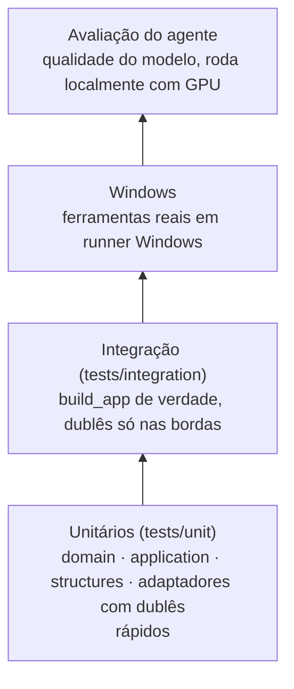

# 07 · Desenvolvimento

## 1. Ambiente

| Requisito | Versão / observação |
|---|---|
| Windows | 10 ou 11, 64 bits |
| Python | 3.12, gerenciado pelo `uv` |
| GPU | NVIDIA com 4 GB+ de VRAM, driver atualizado (referência: GTX 1650 4 GB, ver [ADR-0010](adr/0010-hardware-gpu-4gb.md)) |
| CUDA | Não precisa instalar à parte: o Ollama traz o próprio runtime e a transcrição roda na CPU |
| uv | Gerenciador de projeto e ambientes ([instalação](https://docs.astral.sh/uv/getting-started/installation/)) |
| Ollama | Instalador para Windows, rodando em `127.0.0.1:11434` (a partir da Fase 1) |
| Git | Com `pre-commit` instalado |

**Disponível hoje (marco 1a):**

```powershell
# clonar e preparar
git clone https://github.com/VitorAngN/Shiro-Agente.git
cd Shiro-Agente
uv sync                       # cria .venv e instala dependências travadas
uv run pre-commit install     # o hook do gitleaks baixa o Go sozinho na primeira execução
ollama pull qwen3:4b-instruct # modelo local provisório (ADR-0010)

# usar e verificar
uv run shiro chat -v          # agente por texto, com diagnóstico de cada turno
uv run shiro config check
uv run pytest
```

A configuração pessoal (apps, cidade do clima) vai no `shiro.toml` mostrado por `shiro config path`, fora do repositório. Ver `config/shiro.example.toml`.

**Planejado para os próximos marcos:**

```powershell
uv run shiro secrets set gemini      # chave vai para o Gerenciador de Credenciais do Windows
uv run shiro                         # modo completo, com voz (marco 1b)
```

### Verificações locais

| Comando | O que verifica |
|---|---|
| `uv run ruff check .` e `uv run ruff format --check .` | Estilo e erros comuns |
| `uv run pyright` | Tipos (estrito no núcleo, política, LLM, atividades e configuração) |
| `uv run lint-imports` | Regras de arquitetura: o núcleo não importa adaptadores |
| `uv run pytest --cov` | Testes e cobertura (mínimo de 80%) |
| `uv run pre-commit run --all-files` | Tudo acima + segredos e arquivos |

## 2. Convenções

| Tema | Convenção |
|---|---|
| Idioma | Código e identificadores em inglês. Documentação e falas do SHIRO em pt-BR |
| Estilo | `ruff format` + `ruff check` (inclui regras de import, bugbear, segurança) |
| Tipos | `pyright --strict` em `structures`, `domain`, `application`, `config`, `infrastructure/llm` e `interfaces/api`; modo padrão no restante |
| Docstrings | Estilo Google, obrigatórias em portas e ferramentas |
| Commits | [Conventional Commits](https://www.conventionalcommits.org/): `feat(voice): …`, `fix(policy): …` |
| Branches | `main` sempre verde; trabalho em `feat/…`, `fix/…`, `docs/…` com PR (mesmo sozinho, para manter o histórico) |
| Versão | SemVer. `0.x` até a Fase 2 |
| Changelog | `CHANGELOG.md` no formato Keep a Changelog |
| Decisões | Mudança de arquitetura ou de dependência importante → ADR novo |
| Onde fica o código | Pela camada ([ADR-0020](adr/0020-camadas-e-estruturas-de-dados.md)): regra pura em `domain`, caso de uso em `application`, I/O em `infrastructure`, entrada em `interfaces`. A CI recusa import contra a regra |
| Onde fica o teste | `tests/unit/` espelha `src/shiro/` (`domain/voice/endpointing.py` → `tests/unit/domain/voice/test_endpointing.py`); o que monta o app real vai para `tests/integration/`; dublês compartilhados em `tests/fakes/`. Um arquivo de teste não importa outro |

## 3. Estratégia de testes



| Camada | Ferramentas | Onde roda |
|---|---|---|
| Unitários | `pytest`, `pytest-asyncio`, `hypothesis` para o motor de políticas e a validação de caminhos | CI Ubuntu e Windows |
| Integração | `FakeLLMProvider` com respostas roteirizadas; respostas reais dos provedores gravadas como fixtures | CI |
| Windows | Ferramentas de áudio, apps e arquivos, com marcador `@pytest.mark.windows` | CI Windows |
| Ollama real | Marcador `@pytest.mark.ollama` | Local |
| Avaliação | `evals/run.py` | Local, a cada mudança de prompt, modelo ou ferramenta |

### Avaliação do agente

Testes comuns dizem se o código está certo. A **avaliação** diz se o modelo está escolhendo as ações certas. Cada linha de `evals/datasets/comandos_ptbr.jsonl` é um caso:

```json
{"id": "vol-01", "fala": "abaixa o volume pra 20", "tier_esperado": "T0", "chamadas": [{"tool": "set_volume", "args": {"level": 20}}]}
```

O script roda todos os casos contra um modelo e gera um relatório com:

- acerto da ferramenta escolhida e dos argumentos;
- casos em que o modelo deveria ter recusado ou pedido esclarecimento;
- latência p50 e p95 por caso.

É assim que o modelo local padrão é escolhido na Fase 1 e que regressões de prompt são detectadas depois.

## 4. CI (GitHub Actions)

| Job | Executa |
|---|---|
| `lint` | `ruff check`, `ruff format --check` |
| `types` | `pyright` |
| `arch` | `import-linter`: o núcleo não importa adaptadores |
| `test-linux` | Testes unitários e de integração |
| `test-windows` | Tudo acima + testes `windows` |
| `security` | `gitleaks`, `pip-audit` |

## 5. Definição de pronto de um PR

- [ ] CI verde
- [ ] Testes novos para o comportamento novo
- [ ] Ferramenta nova passou pelo [checklist de segurança](05-seguranca.md#checklist)
- [ ] Avaliação rodada localmente se mexeu em prompt, modelo ou ferramenta, sem queda de acerto
- [ ] Documentação e `CHANGELOG.md` atualizados
- [ ] ADR criado se a mudança altera uma decisão registrada
