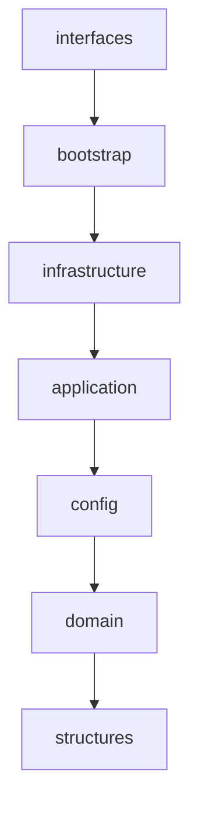

# 09 · Orientação a objetos e estruturas de dados

Onde cada conceito aparece no código, e por quê. A organização em camadas está no [ADR-0020](adr/0020-camadas-e-estruturas-de-dados.md); a arquitetura geral, no [documento 03](03-arquitetura.md).

## 1. Árvore do projeto

```text
src/shiro/
├── domain/                     # regras puras e portas; sem I/O
│   ├── models.py               # ToolCall, ToolResult, AgentResult, RiskLevel…
│   ├── events.py               # Event e subclasses (TurnStarted, ToolCallCompleted…)
│   ├── ports.py                # Protocols: LLMProvider, Tool, Clock, Notifier…
│   ├── text.py  ids.py         # normalização pt-BR, uuid7
│   ├── activities/             # Activity, Job, datas em pt-BR, busca por nome
│   ├── memory/                 # MemoryFact, Embedder, HashingEmbedder, CachedEmbedder
│   ├── policy/                 # PolicyEngine (R0–R4, taint, lotes)
│   └── voice/                  # Audio, portas de voz, Endpointer, "Ei, Shiro"
├── application/                # casos de uso
│   ├── agent/                  # AgentLoop, IntentRouter, ContextBuilder, claims
│   ├── activities/  memory/    # serviços, regras do Tier 0 e ferramentas
│   ├── voice/listening.py      # ouvir uma frase
│   ├── bus.py                  # EventBus
│   ├── registry.py             # ToolRegistry
│   ├── routines.py             # rotinas do shiro.toml
│   └── scheduler.py            # Scheduler + WatchedJobStore
├── config/                     # Settings (pydantic-settings) e pastas
├── infrastructure/             # adaptadores das portas
│   ├── llm/                    # Ollama, Gemini, GuardedProvider, FallbackProvider
│   ├── persistence/            # SQLite: um repositório por agregado, auditoria
│   ├── embeddings/             # ONNX e download do modelo
│   ├── tools/  tools/windows/  # ferramentas nativas e os adaptadores do Windows
│   ├── voice/  voice/windows/  # Whisper, Kokoro, SAPI, Silero, microfone
│   ├── observability/          # logs, notificações em log
│   └── system/                 # relógio, cofre, instância única, autostart, downloads
├── bootstrap/                  # raiz de composição (build_app)
├── interfaces/                 # cli/, text/, voice/, tray/, api/ (painel)
└── structures/                 # heap, ring, window, lru, trie, hashchain, vector_index

tests/
├── unit/<mesma árvore>/test_<módulo>.py
├── integration/                # o app montado de verdade, dublês só nas bordas
└── fakes/                      # dublês compartilhados (agent, clock, desktop, voice…)
```

Regra de dependência, verificada pelo `import-linter` na CI:



Uma camada importa só as de baixo. Domínio, aplicação e estruturas não podem importar bibliotecas de I/O.

## 2. Conceitos de POO

| Conceito | Onde | Como |
|---|---|---|
| **Abstração** | `domain/ports.py`, `domain/voice/ports.py`, `MemoryStore`, `JobStore`, `Embedder` | O agente conversa com um `LLMProvider`, não com o Ollama. As portas são `typing.Protocol`: subtipagem estrutural. Um dublê de teste só precisa ter os métodos, sem herdar de nada |
| **Encapsulamento** | `RingBuffer`, `PriorityQueue`, `MemoryService`, `Scheduler` | Estado interno com `_` e acesso por métodos e propriedades só de leitura (`capacity`, `embedder`). Quem usa o heap não mexe na lista, e o invariante continua válido |
| **Herança** | `Event` → `TurnStarted`, `ToolCallCompleted`, `TurnFinished`; `_Section` → seções do `Settings` | Usada onde existe "é um" de verdade: todo evento tem `trace_id` e `ts`; toda seção de configuração é imutável e recusa chave desconhecida |
| **Polimorfismo** | `LLMProvider`: `OllamaProvider`, `GeminiProvider`, `GuardedProvider`, `FallbackProvider`. `Embedder`: `HashingEmbedder`, `OnnxEmbedder`, `CachedEmbedder`. `TextToSpeech`: `KokoroProcessTTS`, `SapiTTS` | O mesmo `await provider.complete(pedido)` funciona com qualquer um |
| **Composição** | `App`, `VoiceRuntime`, `AgentLoop` | Objetos montados com outros objetos, injetados pelo construtor. A herança fica para eventos e configuração |
| **Imutabilidade** | `ToolCall`, `ToolResult`, `Activity`, `Job`, `MemoryFact` (pydantic `frozen`); `Item`, `Match`, `ChainRecord` (`dataclass(frozen=True)`) | Objetos de valor não mudam depois de criados: podem ir para outra tarefa do asyncio ou para o log sem cópia defensiva |
| **Genéricos** | `PriorityQueue[P, K]`, `RingBuffer[T]`, `LRUCache[K, V]`, `KeywordTrie[V]`, `VectorIndex[K]` | Sintaxe da PEP 695; o pyright estrito confere os tipos em todo uso |
| **Protocolo de dados** | `__len__`, `__contains__`, `__iter__`, `__getitem__`, `__bool__` nas estruturas | `len(fila)`, `"x" in cache`, `for quadro in buffer`: as estruturas se comportam como as coleções do Python |
| **Injeção de dependência** | relógio, repositórios, embedder, notificador | Construtores recebem as dependências; só `bootstrap/` sabe quais são as concretas. Os testes trocam o relógio por `MovableClock` |

## 3. Padrões de projeto

| Padrão | Onde | Para quê |
|---|---|---|
| **Adapter** | `infrastructure/**`: `SqliteJobStore`, `OllamaProvider`, `SapiTTS`, `tools/windows/*` | Cada um traduz uma porta do domínio para uma tecnologia |
| **Repository** | `SqliteActivityStore`, `SqliteJobStore`, `SqliteMemoryStore`, `SqliteConversationStore` | O domínio pede "atividades pendentes", não SQL |
| **Strategy** | `Embedder` (radicais ou ONNX), `build_tts` (Kokoro ou SAPI), palavra de ativação (Whisper ou openWakeWord) | Escolhida na configuração, sem `if` espalhado pelo código |
| **Decorator** | `GuardedProvider` (limites em volta de um provedor), `CachedEmbedder` (cache em volta de um embedder), `WatchedJobStore` (avisa o agendador em volta de um repositório), `CommandRescoringSTT` (corrige comandos em volta do Whisper, ADR-0021) | Comportamento a mais sem mudar a classe original e sem herança |
| **Chain of Responsibility** | `FallbackProvider` (tenta os provedores em ordem); regras do Tier 0 no `IntentRouter` (cada regra devolve chamadas ou `None` e passa adiante) | Quem não resolve deixa para o próximo |
| **Observer** | `EventBus` (`subscribe`/`publish`), `EventFanout` (WebSocket do painel), `WatchedJobStore` → `Scheduler` | Quem publica não conhece quem ouve: a auditoria, a conversa e o painel assinam os mesmos eventos |
| **Command** | `ToolCall` (nome + argumentos), executado pelo `AgentLoop` depois da política; rotinas são listas de comandos | O pedido vira um objeto que pode ser validado, confirmado, auditado e só então executado |
| **Factory** | `build_app`, `build_local_llm`, `build_cloud_llm`, `build_tts`, `build_embedder` | A criação, com as escolhas da configuração, fica num lugar só |
| **Facade** | `App` (agente, registro, serviços e banco), `VoiceRuntime` | A CLI, a bandeja e o painel usam um objeto, não vinte |
| **Registry** | `ToolRegistry` | Ferramentas entram por nome e grupo; o agente pede as do assunto |
| **State machine** | `Endpointer` (`WAITING` → `SPEAKING` → `DONE`/`NO_SPEECH`), `VoiceSession` (`IDLE`, `LISTENING`, `THINKING`, `SPEAKING`) | Estados e transições explícitos; o ícone da bandeja segue o estado |

## 4. Estruturas de dados

Todas em `src/shiro/structures/`, genéricas e testadas em `tests/unit/structures/`.

### 4.1 Fila de prioridade (`heap.py`)

Heap binário mínimo sobre `heapq`, com uma chave por item e remoção preguiçosa.

- **Invariante:** cada nó é menor ou igual aos filhos (`2i+1`, `2i+2`); a menor prioridade está sempre na posição 0.
- **Estável:** um contador desempata prioridades iguais pela ordem de chegada.
- **Remoção preguiçosa:** `discard` marca a entrada, que sai quando chega ao topo. Quando as marcas passam da metade, o heap é reconstruído em O(n).

| `push` | `pop` | `peek` | `discard` | `of` (heapify) |
|---|---|---|---|---|
| O(log n) | O(log n) amortizado | O(1) amortizado | O(1) | O(n) |

**Uso:** o agendador. Antes ele consultava o banco a cada 15 s, e um lembrete podia atrasar esse tanto. Agora o laço dorme até `fila.peek()`, ou até um trabalho novo entrar (`WatchedJobStore` avisa). O banco continua sendo a fonte da verdade; a fila só diz quando acordar.

### 4.2 Buffer circular (`ring.py`)

Vetor pré-alocado de capacidade fixa, com o índice do mais antigo; inserir com o buffer cheio sobrescreve esse item.

| `append` | `[i]` | iterar |
|---|---|---|
| O(1) | O(1) | O(n) |

**Uso:** o pré-roll do `Endpointer`. São os ~300 ms de áudio antes do início da fala, para a primeira sílaba não ser cortada. Antes, cada quadro (31 por segundo) criava uma lista nova com o fatiamento `frames[-k:]`. Também guarda os grupos de ferramentas dos dois últimos turnos do agente.

### 4.3 Janela deslizante (`window.py`)

Fila FIFO (`deque`) de instantes em ordem crescente; os que saem da janela são removidos pelo começo.

| `add` | `count` | `wait_for_slot` |
|---|---|---|
| O(1) | O(1) amortizado | O(1) amortizado |

**Uso:** o limite de requisições por minuto da nuvem (`GuardedProvider`).

### 4.4 Cache LRU (`lru.py`)

Tabela hash mais lista duplamente ligada, as duas no `OrderedDict`: achar é O(1), e a ordem de uso diz quem sai quando estoura a capacidade. Conta acertos, faltas e expulsões.

**Uso:** `CachedEmbedder`, um decorador do embedder. Toda fala calcula um vetor para buscar memórias; frases repetidas ("que horas são?") saem do cache, e as que faltam vão juntas ao modelo numa chamada só.

### 4.5 Trie de palavras-chave (`trie.py`)

Árvore de caracteres. Uma chave é exata (`"pdf"`, `"na web"`) ou um radical (`"lembr*"`). Em cada início de palavra, a busca desce pela trie e fica com a chave **mais longa** que casou. Os nós usam `__slots__`.

| inserir | procurar no texto |
|---|---|
| O(tamanho da chave) | O(n·L), sem depender de quantas chaves existem |

**Uso:** a seleção de ferramentas por assunto (ADR-0018). As palavras de cada grupo viraram dados em `bootstrap/tools.py` (`TOOL_GATES`), no lugar de expressões regulares. Exceções são chaves com valor `None`: "memoria ram" é mais longa que "memoria*", então "quanta memória RAM?" não traz as ferramentas de memória.

### 4.6 Cadeia de hashes (`hashchain.py`)

Lista encadeada em que cada elo guarda o hash do anterior: `hash = SHA-256(prev_hash + campos)`. Alterar ou apagar um elo do meio quebra o seguinte, como nos commits do git. `ChainVerifier` confere um registro por vez, lendo direto do cursor do SQLite.

**Uso:** o log de auditoria (`infrastructure/persistence/audit.py`), que só guarda e lê; o algoritmo é testado sem banco.

### 4.7 Índice de vetores (`vector_index.py`)

Matriz `n × d` contígua (`float32`) com uma lista paralela de chaves. Buscar é um produto matriz-vetor, e `argpartition` escolhe os k melhores sem ordenar tudo. Remover troca a linha pela última. Inserções esperam numa lista e entram de uma vez na busca seguinte.

| `add` | `remove` | `search(k)` |
|---|---|---|
| O(d) amortizado | O(d) | O(n·d + n + k log k) |

**Uso:** a memória de longo prazo. Antes, cada turno relia todos os fatos e vetores do SQLite e decodificava os blobs. Agora o índice fica na memória e é atualizado a cada "lembra" e "esquece". Um `PRAGMA data_version` por turno detecta mudanças feitas por outro processo (o painel apagando uma memória) e manda reler.

### 4.8 Estruturas da biblioteca padrão

| Estrutura | Onde |
|---|---|
| `dict` (tabela hash) | registro de ferramentas por nome, fatos por id, filhos de cada nó da trie |
| `set` / `frozenset` | grupos de ferramentas de um pedido (e chave do cache de definições), códigos de login de uso único |
| `asyncio.Queue` | eventos para cada aba do painel (limitada a 100), gatilhos da sessão de voz |
| `asyncio.Event` | acordar o agendador quando um trabalho novo entra |
